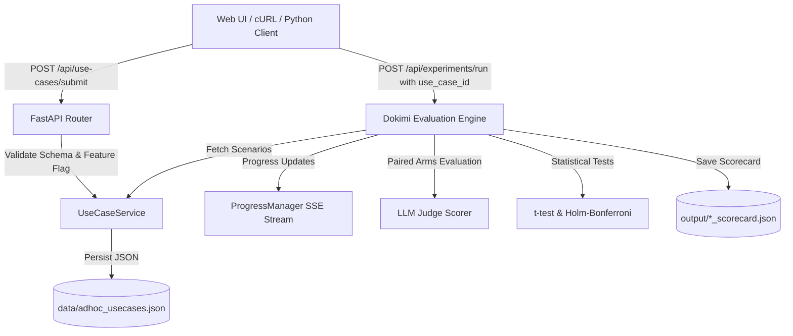

# Ad-Hoc Use-Case Submission & Evaluation Guide

The **Dokimi Agent Context A/B Testing Platform** supports dynamic, runtime submission of **Ad-Hoc Use-Cases** alongside built-in immutable demonstration fixtures (`sre_incident_response`, `cloud_security_audit`). 

This guide provides complete technical documentation for submitting, managing, and running Dokimi A/B evaluations on custom domains, including API specifications, schemas, executable examples (Python & Bash), web form walkthroughs, validation rules, persistence mechanics, and troubleshooting.

---

## Table of Contents
1. [Overview & Core Architecture](#1-overview--core-architecture)
2. [Data Model & Schema Specifications](#2-data-model--schema-specifications)
3. [REST API Endpoint Reference](#3-rest-api-endpoint-reference)
4. [Executable Code Examples](#4-executable-code-examples)
   - [Common Use-Case 1: Database Split-Brain Failover Drill (Python)](#example-1-database-split-brain-failover-drill-python)
   - [Common Use-Case 2: Microservice API Gateway Rate-Limiting (cURL/CLI)](#example-2-microservice-api-gateway-rate-limiting-curlcli)
   - [Common Use-Case 3: Kubernetes Secret Rotation Protocol (Python requests / httpx)](#example-3-kubernetes-secret-rotation-protocol-python)
5. [Web UI Walkthrough](#5-web-ui-walkthrough)
6. [Validation, Error Handling & Immutability Rules](#6-validation-error-handling--immutability-rules)
7. [Storage Persistence & File Lifecycle](#7-storage-persistence--file-lifecycle)
8. [Integration with Dokimi A/B Evaluation Pipeline](#8-integration-with-dokimi-ab-evaluation-pipeline)
9. [Troubleshooting & Common Submission Errors](#9-troubleshooting--common-submission-errors)

---

## 1. Overview & Core Architecture

An **Ad-Hoc Use-Case** allows teams to test context-augmentation techniques (runbooks, persona profiles, precision skills) against domain-specific scenarios without modifying backend Python code or restarting services.

### Key Capabilities
- **Zero-Downtime Registration**: Add new evaluation domains at runtime via `POST /api/use-cases/submit` or the Web UI.
- **Unified A/B Execution Pipeline**: Evaluates all configured context arms (`baseline`, `docs`, `profile`, `skill`) against custom scenario prompts using Dokimi paired on/off testing.
- **Dynamic Scenario-to-Question Mapping**: Automatically transforms scenario prompts and expected assertions into golden evaluation items for LLM-as-a-Judge scoring.
- **Statistically Significant Scoring**: Computes paired Student's $t$-test $p$-values and Holm-Bonferroni multi-arm corrections ($\alpha=0.05$).
- **Dual-Tier Persistence**: Built-in fixtures stay immutable in code memory, while ad-hoc use-cases are persisted in [`data/adhoc_usecases.json`](../data/adhoc_usecases.json).



---

## 2. Data Model & Schema Specifications

The schemas correspond directly to the Pydantic v2 models defined in [`app/core/models.py`](../app/core/models.py:30).

### Schema: `UseCaseScenario`
Represents an individual test query / prompt within a use-case.

| Field | Type | Required | Description | Example |
|---|---|---|---|---|
| `id` | `str` | Yes | Unique scenario identifier | `"db_failover_1"` |
| `prompt` | `str` | Yes | User prompt / incident query to evaluate | `"Primary Raft leader down, how to recover quorum?"` |
| `expected_topics` | `List[str]` | No (Default: `[]`) | Key ground truth concepts / assertions required in agent answer | `["quorum check", "step-down", "elect candidate"]` |
| `category` | `str` | No (Default: `"general"`) | Domain category or functional area | `"High Availability"` |

### Schema: `SubmitUseCaseRequest` (Submission Payload)
Payload sent to `POST /api/use-cases/submit`.

| Field | Type | Required | Description | Constraints |
|---|---|---|---|---|
| `name` | `str` | Yes | Human-readable title | `min_length=2` |
| `description` | `str` | No | Objectives and scope | Default: `""` |
| `parameters` | `Dict[str, Any]` | No | Thresholds and evaluation hyper-parameters | Default: `{}` |
| `expected_outputs` | `List[str]` | No | Global success criteria | Default: `[]` |
| `scenarios` | `List[UseCaseScenario]` | Yes | List of evaluation scenarios | `min_length=1` |
| `custom_variants` | `List[VariantConfig]` | No | Optional custom context arms tailored for this use-case | Default: `None` |

### Schema: `UseCase` (Stored / Response Entity)
Full entity returned by API and persisted to disk.

```json
{
  "id": "adhoc_20261027_120000_a1b2",
  "name": "Database Failover Drill",
  "description": "Evaluation of distributed consensus recovery",
  "source": "adhoc",
  "is_mutable": true,
  "parameters": {
    "domain": "Database SRE",
    "alpha": 0.05,
    "min_score_threshold": 0.70
  },
  "expected_outputs": [
    "Identify Raft quorum loss",
    "Preserve ACID guarantees"
  ],
  "scenarios": [
    {
      "id": "sc_1",
      "prompt": "Primary node unresponsive, how to promote replica?",
      "expected_topics": ["promote", "failover", "quorum"],
      "category": "High Availability"
    }
  ],
  "custom_variants": null,
  "created_at": "2026-10-27T12:00:00Z",
  "updated_at": "2026-10-27T12:00:00Z"
}
```

---

## 3. REST API Endpoint Reference

### 1. `POST /api/use-cases/submit`
Submit and register a dynamic ad-hoc use-case.

- **Status Code**: `200 OK`
- **Feature Flag Guard**: Controlled by `ALLOW_ADHOC_USECASES` in `.env` (returns `403 Forbidden` if disabled).
- **Request Body**: `SubmitUseCaseRequest` (JSON)
- **Response Body**: `UseCase` (JSON)

### 2. `GET /api/use-cases`
List all registered use-cases (merges immutable hardcoded fixtures and dynamic ad-hoc submissions).

- **Status Code**: `200 OK`
- **Response Body**: `List[UseCase]`

### 3. `GET /api/use-cases/{usecase_id}`
Retrieve complete metadata and test scenarios for a single use-case.

- **Status Code**: `200 OK` (or `404 Not Found` if missing)
- **Response Body**: `UseCase`

### 4. `DELETE /api/use-cases/{usecase_id}`
Delete an ad-hoc use-case and remove it from [`data/adhoc_usecases.json`](../data/adhoc_usecases.json).

- **Status Code**: `200 OK` (`{"status": "deleted", "use_case_id": "..."}`)
- **Error Responses**:
  - `400 Bad Request`: If attempting to delete an immutable fixture (`sre_incident_response` or `cloud_security_audit`).
  - `404 Not Found`: If target ad-hoc use-case does not exist.

### 5. `GET /api/questions?use_case_id={usecase_id}`
Retrieve the evaluation question set dynamically generated from the use-case scenarios.

### 6. `POST /api/experiments/run`
Trigger a Dokimi A/B experiment targeted at a specific use-case.

- **Payload Example**:
  ```json
  {
    "name": "Database Failover Context Optimization",
    "use_case_id": "adhoc_20261027_120000_a1b2",
    "model": "mock-model",
    "provider": "mock"
  }
  ```

---

## 4. Executable Code Examples

### Example 1: Database Split-Brain Failover Drill (Python)

Save as `submit_db_usecase.py` and run with `.venv/bin/python submit_db_usecase.py`:

```python
import json
import urllib.request

BASE_URL = "http://127.0.0.1:8000"

payload = {
    "name": "Database Split-Brain Failover Drill",
    "description": "Assess agent context arms on multi-region Raft quorum recovery and replication lag handling",
    "parameters": {
        "domain": "Database Infrastructure",
        "quorum_type": "Raft",
        "alpha": 0.05,
        "target_score": 0.85
    },
    "expected_outputs": [
        "Detect network partition between primary and secondary AZ",
        "Verify Raft quorum status (N/2 + 1)",
        "Isolate minority node using STONITH / fencing",
        "Execute automated promote with zero data loss"
    ],
    "scenarios": [
        {
            "id": "db_sc_01",
            "prompt": "Leader node in us-east-1a is partitioned from us-east-1b and us-east-1c. How do we prevent split-brain writes?",
            "expected_topics": [
                "Verify Raft consensus quorum across surviving AZs",
                "Force step-down or fence partitioned leader node",
                "Ensure client traffic routes to elected majority leader",
                "Monitor replication lag and write acknowledgement"
            ],
            "category": "High Availability"
        },
        {
            "id": "db_sc_02",
            "prompt": "Replica node reports replication lag of 45 seconds during failover. How do we safely promote it without dropping transactions?",
            "expected_topics": [
                "Check WAL replay position / LSN numbers",
                "Drain in-flight transaction queues before failover trigger",
                "Validate synchronous commit status",
                "Perform safe promotion with pg_promote or orchestrator"
            ],
            "category": "Data Consistency"
        }
    ]
}

# 1. Submit Ad-Hoc Use-Case
req = urllib.request.Request(
    f"{BASE_URL}/api/use-cases/submit",
    data=json.dumps(payload).encode("utf-8"),
    headers={"Content-Type": "application/json"},
    method="POST"
)

with urllib.request.urlopen(req) as resp:
    use_case = json.loads(resp.read().decode("utf-8"))
    uc_id = use_case["id"]
    print(f"✅ Successfully registered ad-hoc use-case: {use_case['name']} (ID: {uc_id})")

# 2. Trigger Dokimi A/B Experiment against this Use-Case
exp_payload = {
    "name": f"{use_case['name']} A/B Eval",
    "use_case_id": uc_id,
    "model": "mock-model",
    "provider": "mock"
}

exp_req = urllib.request.Request(
    f"{BASE_URL}/api/experiments/run",
    data=json.dumps(exp_payload).encode("utf-8"),
    headers={"Content-Type": "application/json"},
    method="POST"
)

with urllib.request.urlopen(exp_req) as resp:
    exp_result = json.loads(resp.read().decode("utf-8"))
    print(f"📊 Experiment Finished: {exp_result['id']}")
    print(f"🏆 Top Arm: {exp_result['summary_verdict']}")
    for arm, metrics in exp_result["metrics_by_arm"].items():
        print(f"  - Arm {arm:12s}: Mean Score = {metrics['mean_score']:.4f} | Sig: {metrics['stat_significant']}")
```

---

### Example 2: Microservice API Gateway Rate-Limiting (cURL/CLI)

#### 1. Submit Use-Case via cURL
```bash
curl -X POST http://127.0.0.1:8000/api/use-cases/submit \
  -H "Content-Type: application/json" \
  -d '{
    "name": "API Gateway Distributed Rate Limiting",
    "description": "Evaluate context arms on handling DDoS traffic spikes and token bucket algorithms",
    "parameters": {
      "gateway": "Envoy",
      "rate_limit_algorithm": "Token Bucket with Redis Cluster",
      "alpha": 0.05
    },
    "expected_outputs": [
      "Return HTTP 429 Too Many Requests with Retry-After header",
      "Enforce tenant tier limits without exhausting Redis memory"
    ],
    "scenarios": [
      {
        "id": "rate_limit_01",
        "prompt": "An unauthenticated client is flooding /v1/auth with 50,000 req/sec. How should the API gateway throttle this traffic?",
        "expected_topics": [
          "Apply global IP rate limit filter on edge proxy",
          "Return 429 with Retry-After header",
          "Shield upstream authentication services",
          "Log security event to SIEM"
        ],
        "category": "Security & Traffic Shaping"
      }
    ]
  }'
```

#### 2. Verify List of Use-Cases
```bash
curl -s http://127.0.0.1:8000/api/use-cases | jq .
```

#### 3. Run Dokimi A/B Eval for the Created Use-Case
```bash
curl -X POST http://127.0.0.1:8000/api/experiments/run \
  -H "Content-Type: application/json" \
  -d '{
    "name": "API Gateway Rate-Limiting Eval",
    "use_case_id": "adhoc_USECASE_ID_HERE",
    "model": "mock-model",
    "provider": "mock"
  }' | jq .summary_verdict
```

---

### Example 3: Kubernetes Secret Rotation Protocol (Python requests / httpx)

```python
import httpx

client = httpx.Client(base_url="http://127.0.0.1:8000")

payload = {
    "name": "Kubernetes Zero-Downtime Secret Rotation",
    "description": "Evaluate context arms on Vault agent injector and automated TLS cert renewal",
    "parameters": {
        "engine": "HashiCorp Vault",
        "cert_manager": "v1.14"
    },
    "expected_outputs": [
        "Rotate mTLS certificates before expiration",
        "Trigger hot reload without terminating active TCP connections"
    ],
    "scenarios": [
        {
            "id": "k8s_secret_01",
            "prompt": "Database credentials rotated in Vault. How does the application pod reload credentials without restarting?",
            "expected_topics": [
                "Vault Agent template watcher triggers sighup/webhook",
                "In-memory connection pool refreshes credentials on next checkout",
                "Ensure zero dropped user requests"
            ],
            "category": "Security"
        }
    ]
}

res = client.post("/api/use-cases/submit", json=payload)
res.raise_for_status()
uc = res.json()
print("Registered use-case ID:", uc["id"])
```

---

## 5. Web UI Walkthrough

The platform provides a dedicated visual management interface in the Web Dashboard.

```
┌────────────────────────────────────────────────────────────────────────────────────────┐
│ 🧪 Dokimi Agent Context A/B Testing                    Provider: [Domain Mock ▾] [Mock]│
├────────────────────────────────────────────────────────────────────────────────────────┤
│ [📊 A/B Experiment Dashboard] [🎯 Use-Case Library] [💬 Chat] [🧬 Variants] [📋 Questions] │
├────────────────────────────────────────────────────────────────────────────────────────┤
│ Use-Case Library                                          [+ Submit Ad-Hoc Use-Case]   │
│                                                                                        │
│ ┌────────┬─────────────────────────────┬───────────┬──────────────┬──────────────────┐ │
│ │ Source │ Use-Case Name               │ Scenarios │ Parameters   │ Actions          │ │
│ ├────────┼─────────────────────────────┼───────────┼──────────────┼──────────────────┤ │
│ │ FIXTURE│ SRE Incident Response       │ 4 items   │ alpha: 0.05  │ [Run Eval] Immut │ │
│ │ FIXTURE│ Cloud Security Compliance   │ 4 items   │ alpha: 0.05  │ [Run Eval] Immut │ │
│ │ AD-HOC │ Database Split-Brain Drill  │ 2 items   │ alpha: 0.05  │ [Run Eval] [Del] │ │
│ └────────┴─────────────────────────────┴───────────┴──────────────┴──────────────────┘ │
└────────────────────────────────────────────────────────────────────────────────────────┘
```

### Step-by-Step Instructions:
1. Open [http://127.0.0.1:8000](http://127.0.0.1:8000).
2. Click the **"🎯 Use-Case Library"** navigation tab.
3. Click the blue **"+ Submit Ad-Hoc Use-Case"** button in the top-right corner.
4. Fill in the modal form:
   - **Use-Case Title**: e.g., `Distributed Database Failover Strategy`.
   - **Description & Objectives**: Summary of the operational domain and goals.
   - **Parameters / Thresholds**: JSON object (e.g. `{"alpha": 0.05, "min_score_threshold": 0.70}`).
   - **Expected Outputs**: 1 success criterion per line.
   - **Evaluation Scenarios**:
     - Click **"+ Add Scenario"** to add scenario rows.
     - Enter the prompt query, category, and expected keywords/topics (comma-separated).
5. Click **"Register Use-Case"**.
6. The new use-case is immediately loaded into the library table and becomes selectable in the header dropdown on the **A/B Experiment Dashboard**.
7. Click **"Run Eval"** next to your use-case to initiate real-time paired Dokimi testing with live progress tracking.

---

## 6. Validation, Error Handling & Immutability Rules

### Validation Rules
1. **Title Length**: `name` must contain at least 2 characters (`min_length=2`).
2. **Scenarios List**: `scenarios` must contain at least 1 scenario item (`min_length=1`).
3. **Valid JSON in Parameters**: If parameters are passed, they must form a valid key-value JSON dictionary.
4. **Feature Flag Check**: If `ALLOW_ADHOC_USECASES=false` is configured in `.env`, submissions are rejected with `HTTP 403 Forbidden`.

### Immutability & Safety Constraints
- Built-in demonstration fixtures (`sre_incident_response`, `cloud_security_audit`) have `source: "hardcoded"` and `is_mutable: false`.
- Calling `DELETE /api/use-cases/sre_incident_response` or `DELETE /api/use-cases/cloud_security_audit` is explicitly blocked by [`UseCaseService.delete_adhoc_usecase()`](../app/services/usecase_service.py:224) and returns `HTTP 400 Bad Request`.
- Only ad-hoc use-cases (`source: "adhoc"`) can be deleted.

---

## 7. Storage Persistence & File Lifecycle

Ad-hoc use-cases are persisted in [`data/adhoc_usecases.json`](../data/adhoc_usecases.json):

```
data/
├── docs/                     # Static markdown runbooks
├── skills/                   # Agent skill protocols
├── profiles/                 # System prompt personas
├── eval_sets/
│   └── incident_questions.json
└── adhoc_usecases.json       # <--- Persistent store for dynamic use-cases
```

### Persistence Guarantees:
- **Atomicity**: On every submit or delete operation, [`UseCaseService.save_adhoc_usecases()`](../app/services/usecase_service.py:162) serializes the dictionary to disk with UTF-8 encoding.
- **Server Restarts**: When the FastAPI application restarts, `UseCaseService.load_adhoc_usecases()` automatically reloads all previously registered ad-hoc use-cases without data loss.
- **Git Separation**: User-submitted ad-hoc test definitions remain local in `data/adhoc_usecases.json`.

---

## 8. Integration with Dokimi A/B Evaluation Pipeline

When you run an experiment targeting an ad-hoc use-case (`use_case_id: "adhoc_..."`):

1. **Scenario-to-Question Transformation**: [`UseCaseService.get_questions_for_usecase()`](../app/services/usecase_service.py:240) converts each `UseCaseScenario` into a Dokimi `QuestionItem`.
2. **Paired Execution Across Arms**: [`DokimiEvaluationEngine.run_experiment()`](../app/services/dokimi_engine.py:93) executes each context arm (`baseline`, `docs`, `profile`, `skill`) against every scenario question in identical conditions.
3. **Real-time SSE Progress**: [`ProgressManager`](../app/services/progress_manager.py:1) streams live completion percentages and step details (`TaskProgress`) to the Web UI.
4. **Statistical Grading**:
   - Scores each answer on Accuracy (45%), Completeness (40%), and Conciseness (15%).
   - Performs a two-sided **paired Student's $t$-test** between each treatment arm and baseline.
   - Applies **Holm-Bonferroni correction** across arms to guarantee statistical validity.
   - Decomposes knowledge atoms to highlight novel facts added.
5. **Output Persistence**: Results are saved as timestamped JSON reports in `output/` (e.g. `output/experiment_YYYYMMDD_HHMMSS_scorecard.json`).

---

## 9. Troubleshooting & Common Submission Errors

### Common Issues & Remedies

| Error / Symptom | Cause | Solution |
|---|---|---|
| `HTTP 403 Forbidden: Ad-hoc use-case submission is disabled` | `ALLOW_ADHOC_USECASES=false` in `.env` | Set `ALLOW_ADHOC_USECASES=true` in `.env` and restart the application via `./scripts/stop.sh && ./scripts/start.sh`. |
| `HTTP 422 Unprocessable Entity: scenarios min_length` | Submitted payload had an empty `scenarios: []` list | Provide at least one scenario item in the `scenarios` array. |
| `HTTP 400 Bad Request: Cannot delete hardcoded fixture` | Attempted to delete `sre_incident_response` or `cloud_security_audit` | Hardcoded fixtures are immutable by design. Delete only ad-hoc use-cases. |
| `HTTP 404 Not Found: Use-case not found` | The specified `use_case_id` does not exist | Verify the use-case ID using `GET /api/use-cases`. |
| `Invalid JSON in Parameters field` (Web UI) | Syntax error in parameters JSON text | Ensure JSON format uses double quotes around keys and values (e.g. `{"alpha": 0.05}`). |
| `Connection refused on localhost:8000` | Application server is not running | Start the background server using `./scripts/start.sh`. |

---

## 10. Summary Reference

- **Web Dashboard**: [http://127.0.0.1:8000](http://127.0.0.1:8000)
- **API Swagger Docs**: [http://127.0.0.1:8000/docs](http://127.0.0.1:8000/docs)
- **Use-Cases API**: [http://127.0.0.1:8000/api/use-cases](http://127.0.0.1:8000/api/use-cases)
- **Use-Case Model Schema**: [`app/core/models.py`](../app/core/models.py:30)
- **Service Implementation**: [`app/services/usecase_service.py`](../app/services/usecase_service.py:1)
