# Architecture Specification: Dokimi Agent Context A/B Testing Platform

## Overview
The **Dokimi Agent Context A/B Testing Platform** provides systematic, statistically-grounded experimentation to determine whether injecting specific context (system profiles, internal documentation runbooks, agent skills, or MCP tooling) improves AI agent performance.

It incorporates Intel's [Dokimi](https://github.com/intel/dokimi) evaluation principles:
1. **Paired On/Off Arm Comparisons**: Every context arm is evaluated against the exact same question/scenario sets to compute delta scores.
2. **Knowledge Atom Decomposition**: Context is evaluated not merely on volume, but whether it adds novel facts, repeats redundant knowledge, or degrades accuracy.
3. **Statistical Significance Testing**: Paired Student's t-test with **Holm-Bonferroni** family-wise error rate corrections.

---

## Architectural Flow Diagram

```mermaid
graph TD
    User([User / SRE Engineer]) -->|Interacts via Browser| WebUI[FastAPI Frontend Dashboard]
    
    subgraph Frontend [Presentation Layer - Carbon Plex Dark Theme]
        WebUI --> Tab1[A/B Experiment Dashboard]
        WebUI --> Tab2[Use-Case Library - Fixtures & Ad-Hoc]
        WebUI --> Tab3[Dual Agent Chat Playground]
        WebUI --> Tab4[Context Arms & Variants Manager]
        WebUI --> Tab5[Evaluation Question Set Manager]
        Tab1 --> ECharts[Interactive ECharts Visualization]
    end

    subgraph Backend [FastAPI Application Core]
        API[REST API Router] --> UseCaseSvc[UseCase Service]
        API --> Engine[Dokimi Evaluation Engine]
        API --> ChatSvc[Interactive Chat Handler]
        API --> ProgMgr[Progress Manager & SSE Streamer]
        
        Engine --> UseCaseSvc
        Engine --> Evaluator[LLM-as-a-Judge Scorer]
        Engine --> Stats[Statistical Analysis Engine]
        Engine --> ProgMgr
        Stats --> TTest[Paired t-test]
        Stats --> Holm[Holm-Bonferroni Correction]
        
        ChatSvc --> LLMDispatcher[LLM Service Dispatcher]
        Evaluator --> LLMDispatcher
    end

    subgraph LLM_Layer [Model Execution Layer]
        LLMDispatcher --> MockEngine[Domain SRE Mock Engine]
        LLMDispatcher --> LiteLLM[LiteLLM Provider: OpenAI / Anthropic]
        LLMDispatcher --> LocalLLM[Local LLM: Ollama / Llama.cpp]
    end

    subgraph Data_Storage [Persistent Storage & Context Repository]
        ArmsRepo[(data/profiles, data/docs, data/skills)]
        EvalSets[(data/eval_sets/incident_questions.json)]
        AdHocStorage[(data/adhoc_usecases.json)]
        OutputStorage[(output/ Scorecards & Reports)]
    end

    UseCaseSvc --> AdHocStorage

    Engine --> ArmsRepo
    Engine --> EvalSets
    Engine --> OutputStorage
```



---

## Component Details

### 1. Context Arms Under Test
| Arm ID | Spec Type | Injected Payload | Purpose |
|---|---|---|---|
| `baseline` | `baseline` | Empty (Unprompted) | Establishes model foundational performance baseline. |
| `arm_docs` | `docs:local:path` | `standard_runbook.md` | Measures value of standard static procedural documentation. |
| `arm_profile` | `profile:path` | `sre_expert_profile.md` | Measures value of domain persona & behavioral guidelines. |
| `arm_skill` | `skill:path` | `SKILL.md` | Measures value of precision action protocols and remediation scripts. |

### 2. Dokimi Evaluation Metrics
- **Mean Score ($S \in [0, 1]$)**: Weighted composite of Accuracy (45%), Grounding Completeness (40%), and Conciseness (15%).
- **Score Delta ($\Delta$)**: Difference in mean score between treatment arm and baseline.
- **Paired $t$-test ($p$-value)**: Tests null hypothesis that context addition produces no difference.
- **Holm-Bonferroni ($\alpha = 0.05$)**: Controls family-wise error across multiple simultaneous arms.
- **Novel Knowledge Atoms**: Measures count of verified facts introduced beyond base model knowledge.

---

## Directory Structure
```
dokimi-agent-ab-testing/
├── app/
│   ├── main.py              # Application entry point & FastAPI setup
│   ├── core/
│   │   ├── config.py        # Settings and environment configuration
│   │   └── models.py        # Pydantic domain models & schemas
│   ├── services/
│   │   ├── dokimi_engine.py # Dokimi evaluation & statistical runner
│   │   ├── progress_manager.py # Real-time progress tracking & SSE streamer
│   │   └── llm_service.py   # LLM dispatcher (Mock & real providers)
│   ├── api/
│   │   └── router.py        # API routes for experiments, variants, chat, tasks
│   ├── templates/
│   │   └── index.html       # Single-page dashboard UI template
│   └── static/
│       ├── css/style.css    # IBM Carbon-inspired styles
│       └── js/app.js        # Dynamic UI logic & ECharts integration
├── data/
│   ├── docs/                # Markdown runbooks for doc arms
│   ├── skills/              # Skill definitions for skill arms
│   ├── profiles/            # Persona prompts for profile arms
│   └── eval_sets/           # Standardized evaluation questions
├── scripts/
│   ├── start.sh             # Detached launch script with URL output
│   ├── stop.sh              # Graceful shutdown script
│   ├── cleanup.sh           # Clean venvs, cache, and build files
│   └── clean_containers.sh  # Remove built container images
├── Docs/
│   ├── Architecture.md      # This document
│   ├── Quickstart.md        # Step-by-step setup and execution guide
│   └── AdHoc_UseCases.md    # Guide and API specs for ad-hoc use-case submissions
├── tests/                   # Pytest test suite
├── Dockerfile & Containerfile
├── requirements.txt
└── README.md
```
