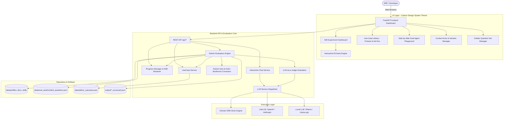

# Dokimi Agent Context A/B Testing Platform

[](https://www.python.org/)
[](LICENSE)
[](https://github.com/intel/dokimi)
[](https://fastapi.tiangolo.com/)

A full-stack, production-ready platform for conducting **A/B testing and context-augmentation evaluation for AI coding and operational agents**, built directly on the methodology and principles of Intel's [Dokimi](https://github.com/intel/dokimi) framework.

---

## 💡 Why A/B Testing for Agent Context?

System prompts, internal runbooks, MCP servers, and agent skills are often authored with large claims, but in practice:
- **Redundancy**: Much of a skill or documentation simply repeats what the LLM already knows in its base weights.
- **Degradation**: Poorly structured context can introduce distraction or degrade output quality.
- **Information Gain**: Only specific, novel knowledge atoms actually improve agent task completion and accuracy.

This platform allows teams to rigorously test whether adding context **actually helps**, measuring statistical deltas ($p$-values, Holm-Bonferroni correction) and knowledge atom gains.

---

## 🏛️ System Architecture



---

## ✨ Key Features

1. **Paired On/Off Arm Evaluation (Dokimi Methodology)**:
   - Evaluates multiple context arms (`baseline`, `docs`, `profile`, `skill`) against the exact same evaluation questions.
   - Computes mean scores, deltas, paired Student's $t$-test $p$-values, and Holm-Bonferroni corrections.
2. **Use-Case Library & Dynamic Ad-Hoc Submissions**:
   - Built-in immutable fixtures (`SRE Incident Response`, `Cloud Security Compliance Audit`).
   - Dynamic ad-hoc registration via `POST /api/use-cases/submit` or UI modal with persistent JSON storage in `data/adhoc_usecases.json`.
   - See [`Docs/AdHoc_UseCases.md`](Docs/AdHoc_UseCases.md) for full guide and API specification.
3. **Knowledge Atom Decomposition (Novelty vs Redundancy)**:
   - Tracks novel facts introduced by context vs redundant knowledge already present in base model weights.
4. **Interactive Side-by-Side Agent Chat Playground**:
   - Query two agent variants simultaneously to visually inspect reasoning, exact commands, latency, and token consumption.
5. **Context Arms & Variants Management**:
   - Create, edit, and inspect context arms using standard Dokimi specs (`baseline`, `docs:local:<path>`, `profile:<path>`, `skill:<path>`).
6. **Dynamic Local Model Discovery (Ollama & llama.cpp)**:
   - Live querying of Ollama (`/api/tags`) and llama.cpp (`/v1/models`) servers.
   - Normalized metadata extraction (parameter count, quantized size in GB/MB, quantization format, and timestamps).
   - Real-time refresh, connection health indicators, and `localStorage` state persistence.
7. **Real-time Visual Analytics & Progress Streaming**:
   - Multi-dimensional ECharts charts for Accuracy, Completeness, Conciseness, and Novelty impact.
   - Live Server-Sent Events (SSE) progress bar with step duration estimates and cancellation.
8. **Production Automation & Containerization**:
   - Bash scripts (`start.sh`, `stop.sh`, `cleanup.sh`, `clean_containers.sh`) and optimized multi-stage `Dockerfile` / `Containerfile`.

---

## 🚀 Quickstart

### 1. Installation
```bash
# Clone and enter directory
cd dokimi-agent-ab-testing

# Create and activate virtual environment with uv (or python3 -m venv)
uv venv .venv --python 3.12
source .venv/bin/activate

# Install dependencies
uv pip install -r requirements.txt
```

### 2. Launch Application
Launch the platform in detached mode:
```bash
./scripts/start.sh
```
Output:
```
=====================================================================
✅ Dokimi Agent A/B Testing Platform is LIVE and HEALTHY!
📌 Process PID:         12345
🌐 Web Dashboard URL:   http://127.0.0.1:8000
📚 API Swagger Docs:    http://127.0.0.1:8000/docs
📖 API Redoc:           http://127.0.0.1:8000/redoc
❤️ Health Check:        http://127.0.0.1:8000/health
🎯 Use-Cases Endpoint:  http://127.0.0.1:8000/api/use-cases
🧬 Variants Endpoint:   http://127.0.0.1:8000/api/variants
📋 Questions Endpoint:  http://127.0.0.1:8000/api/questions
📊 Experiments API:     http://127.0.0.1:8000/api/experiments
📄 Application Logs:    output/app.log
=====================================================================
```

Open [http://127.0.0.1:8000](http://127.0.0.1:8000) in your web browser.

### 3. Graceful Shutdown
```bash
./scripts/stop.sh
```

---

## 🧪 Running Unit Tests
```bash
.venv/bin/pytest tests/ -v
```

---

## 📂 Project Structure
- **Architecture Documentation**: [`Docs/Architecture.md`](Docs/Architecture.md)
- **Quickstart Guide**: [`Docs/Quickstart.md`](Docs/Quickstart.md)
- **Ad-Hoc Use-Cases Guide & API Spec**: [`Docs/AdHoc_UseCases.md`](Docs/AdHoc_UseCases.md)

---

## 📜 License
This project is licensed under the **Apache License 2.0**.
